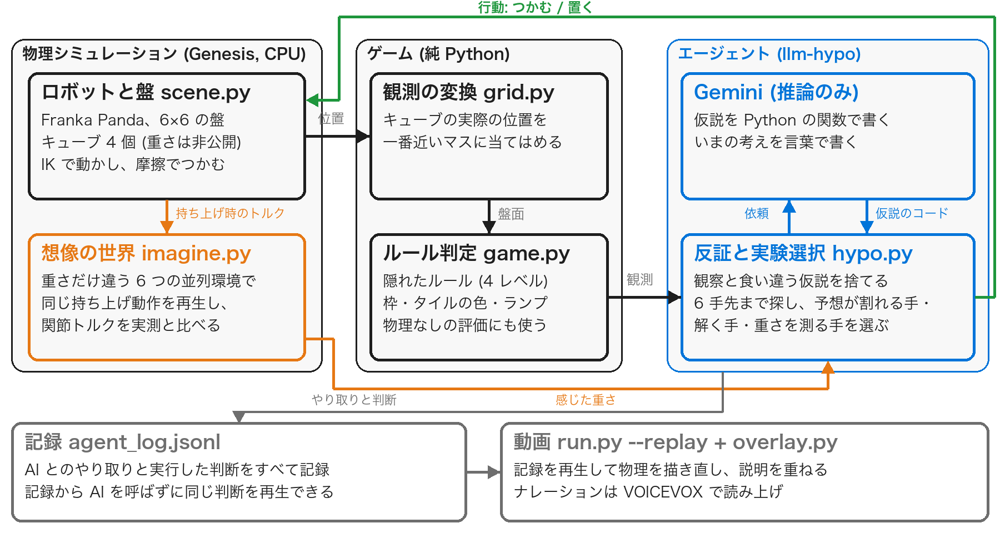

> 非公式の個人作品です。ARC Prize Foundation の ARC-AGI-3 に着想を得ていますが、同財団とは関係がなく、公式のゲームやデータも使っていません。

## 概要 {-}

ロボットアームにルールもゴールも教えないまま、机の上のパズルを解かせてみました。ロボットはキューブを置いてはタイルが光るか、ランプが点くかを確かめ、何をすれば点くのかを探していきます。どこに置くかは Gemini に判断させていて、仮説は言葉ではなく Python の関数で書いてもらうようにしました。観察と食い違う仮説はプログラムで捨て、残った仮説の予想が分かれる一手を選んでからロボットを動かしています。見た目では分からない重さについては、持ち上げたときの関節トルクを、重さだけを変えた 6 つの並列シミュレーションと比べて推定しました。物理シミュレーションのデモでは 4 レベルすべてを解くことができ、重さが鍵になるレベルでは、重さを渡したときに 9 回中 5 回、渡さなかったときは 5 回中 0 回解けています。

## はじめに

### 背景: ルールを知らない状況で学ぶ力

ARC-AGI-3 は 2026 年 3 月に公開された AI のベンチマークで、説明のないゲームを遊びながらルールを見つけられるかを測るものです。人間はすべて解けるのに、公開時点の最先端の AI は 1% 未満しか解けませんでした (<https://arcprize.org/blog/arc-agi-3-launch>)。

私はこれを読んで、この力はロボットにこそ必要だと感じました。工場や家庭で働くロボットは、初めて見る道具や説明書のない機械に出会うことがあります。そのたびに学習し直すより、何度か触ってルールをつかめるほうが、使える場面はずっと広がるはずです。ただ、ロボットの 1 回の動作は画面上のゲームの 1 手より時間がかかり、失敗すればキューブを落としてしまいます。そのため、ゲーム以上に少ない試行で当てることが大事になると考えました。

### この作品で試したこと

ARC-AGI-3 と同じ形のゲームをロボットアームの机の上に作り、次の 2 つを試しました。

1. AI に仮説をプログラムとして書かせ、ロボットを動かす前に、プログラムの上で仮説を見比べる。
2. 見た目では分からない性質 (キューブの重さ) をロボットが触って測り、その値を仮説に使う。

## ゲームの設計

### ロボットにできることと、AI に渡す情報

ロボットにできる行動は、キューブを「つかむ」ことと、マスに「置く」ことの 2 つだけにしました。盤の横のランプが緑になればクリアです。盤は 6×6 のマスで、タイルとキューブには ARC と同じ 10 色を使っています。AI に渡しているのは、色を 0〜9 の数字に置き換えた表と、ランプの状態、それまでの行動とその結果、それに持ち上げたキューブの重さです。

### 4 つのレベルと隠れたルール

レベルは表 1 の 4 つを用意しました。レベルが進むごとに、前のやり方が通じなくなるようにしています。たとえばレベル 1 の「同じ色に置く」は、レベル 2 では隠れた色を見つけないと使えません。レベル 3 では色ではなく数が、レベル 4 では目に見えない重さが鍵になります。

表 1: 各レベルのルール

| レベル | 隠れたルール (AI には教えない) | 見える手がかり | 最短 |
|--|----------------|---------|--|
| 1 | キューブを同じ色のタイルに置く。黄色はおとり | 正しく置くとタイルに白い枠 | 6 手 |
| 2 | オレンジのスイッチに何か載っている間だけ、灰色のタイルの本当の色が見える。その色に合わせる | 灰色のタイルに色が出る | 6 手 |
| 3 | マゼンタの印の数 (3 個) と同じ高さの塔を水色のタイルに作る | 積むたびに印が 1 つ光る | 6 手 |
| 4 | 天秤。栗色の 2 枚の皿が釣り合うと点く。重さは青 0.3、黄 0.2、緑 0.1、赤 0.04 kg で、青 = 緑 + 黄 | 重い側の皿に白い枠。重さは持ち上げて感じる | 6 手 |

## システムの作り

### 全体の構成: ロボット・ゲーム・AI の分担

図 2 のように、ロボットの動作とゲームの判定は別のプログラムに分けました。ロボットには指示された動作をさせるだけにして、動作が終わったら、キューブの実際の位置を一番近いマスに当てはめて盤面を作り、それを `game.py` に渡して枠やランプを決めています。こうしておくと、つかみ損ねてキューブが動かなかったときには、盤面もそのまま変わりません。また、同じ `game.py` を、物理を動かさない評価 (4 章) にも使い回せます。

### AI の仮説をプログラムで確かめ、次の一手を選ぶ仕組み

AI には、ランプが点く条件の仮説を Python の関数で 2〜4 個書いてもらっています。レベル 1 であれば、「赤を (1,1) に置くと点く」「青を (2,4) に置くと点く」といった関数です。書かれた関数は、それまでに見たすべての盤面に当てはめ、実際の結果と食い違うものをその場で捨てます。この照合はプログラムだけで済むので、AI を呼ぶ必要はありません。

次の一手もプログラムで選ぶようにしました。キューブが 4 個なら 6 手先までの盤面は数千通りしかないので、それをすべてたどり、残った仮説の予想が「点く」と「点かない」に分かれる盤面を探して、そこへ向かう手を試します。すべての仮説が「点く」と予想する盤面が見つかれば、そこへ向かって解きにいきます。ロボットの動作はやり直しがきかないので、動かす前にプログラムの上で仮説を見比べておきたかったからです。なお、キューブがどこへ移るかの予測にはシミュレーションを使いますが、ランプが点くかどうかの予測には AI の仮説しか使っていません。

動画では、AI が書いた仮説を画面の右に並べ、観察と合わずに捨てたものに × を付けて見せています。

### AI の思い込みを崩すための補助情報

AI に聞き直すときには、「白い枠の付いたマスの数」とそれまでずっと一致していた量をプログラムで探して、補助情報として入力に添えるようにしました。探す候補は、各マスの高さ、同じ色のタイルに載ったキューブの数、一番高い塔の高さなどで、どのレベルでも同じ候補を使っています。これは、レベル 3 で AI が色合わせの考えから抜け出せなかったため、後から足したものです (4.4 節、5.1 節)。

### 持ち上げたときの関節トルクから重さを推定する仕組み

キューブを持ち上げると関節トルクが変わりますが、トルクは腕の姿勢やつかみ方によっても変わるので、トルクから重さを出す式を手で作るのは難しいと感じました。そこで、持ち上げる直前の腕とキューブの状態を写したシミュレーションを 6 つ用意し、キューブの重さだけを 0.04 kg から 0.8 kg まで変えて、同じ持ち上げ動作をさせることにしました (図 4)。実際のトルクに一番近い世界の重さを、ロボットが感じた重さとしています (世界と世界の間は補間します)。6 つの世界は Genesis の 1 つのシーンに並べて同時に動かせるので、1 回の推定は 0.3 秒ほどで終わります。推定に使っているのは、持ち上げたときの関節トルクと、持ち上げる直前の状態だけです。試してみると、軽いキューブは 0.040〜0.044 kg、重いキューブは 0.298〜0.300 kg と推定できました。

推定した重さは、AI の仮説の関数から `state.mass(cube)` で使えるようにしてあります。まだ持ち上げていないキューブの重さによって予想が変わる場合には、そのキューブを持ち上げる手を、重さを測る実験として選びます。

## 実験と結果

### 2 種類の評価の方法

評価は 2 種類行いました。1 つは Genesis の物理シミュレーションでロボットを動かすデモで、提出した動画はこれを記録したものです。もう 1 つは、物理を動かさずに `game.py` のルールだけで回す評価で、こちらは速いので同じ条件を何度も試せます。LLM には gemini-3.1-flash-lite (無料枠) を使いました。無料枠には 1 日の上限があるため、LLM を使う条件は 1 条件あたり 2〜9 回しか試せていません。

### 物理シミュレーションでのデモ: 4 レベルすべてを解いた

デモでは 4 レベルすべてを解くことができ、行動回数はレベル 1 から順に 6、22、18、26 手でした。ただし、動画は 2 回の実行をつないでいます。レベル 1、2、4 は 10 月 28 日の実行で、このときはレベル 3 を 30 手で解けませんでした。そこでレベル 3 だけ、3.3 節の補助情報を足したあとの 11 月 1 日の実行に差し替え、動画の中にもそのことを表示しています。11 月 1 日の実行も 4 レベルを順に解いたもので (6、22、18、21 手)、レベル 3 に入るまでの条件は同じです。この日のレベル 4 は、重さをそろえる仮説がないまま、キューブを持ち上げたはずみで皿が釣り合って点いてしまったので、動画には仮説どおりに解いた 28 日の実行を使いました。

レベル 2 で 22 手かかったのは、重さを測る手を何度も選んだためです (図 5)。AI が重さを使う仮説も混ぜて書いてきたので、重さと関係のないレベルでも、先に持ち上げて測る手が選ばれていました。

レベル 3 では、積むたびに印が 1 つずつ光るのを見て、AI は塔の高さに注目しました。「[3,3] に 4 つ全部積む」と考えて積んでいく途中で、3 段目でランプが点いています。高さが鍵であることには気づいていましたが、必要な高さは 4 段だと予想していました。

レベル 4 の AI は、はじめは「栗色のタイルに特定の色を置く」と考えていました。4 つのキューブを持ち上げて重さが分かってから「2 つの皿の重さをそろえる」に考えを変え、26 手目にクリアしています (図 6)。

### 重さを測ることは、レベル 4 の解決に役立ったか

物理を動かさない評価で、感じた重さを AI に渡す場合と渡さない場合を比べました (表 2)。4 レベルを続けて解かせ、各レベルの上限は 30 手にしています。表の「修正」は、5.2 節で説明する等号の扱いの修正のことです。

表 2: レベル 4 のクリア回数

| やり方 | クリア | 行動回数 |
|---|---|---|
| でたらめ (200 回、上限 200 手) | 0% | - |
| 手書きのヒューリスティック | 0% | - |
| llm-hypo、重さなし | 5 回中 0 回 | - |
| llm-hypo、重さあり (修正前) | 5 回中 1 回 | 28 手 |
| llm-hypo、重さあり (修正後) | 9 回中 5 回 | 13 / 14 / 27 / 29 / 30 手 |

重さを渡さないと、5 回とも解けませんでした。解けた回の記録を見ると「2 つの皿の重さが等しい」という仮説が並んでいて、AI が感じた重さを使って考えていたことが分かります。修正後の 9 回は、無料枠の上限で 4 回目までで止まった日 (4 回中 3 回) と、翌日に回した 5 回 (5 回中 2 回) を合わせたものです。

### 補助情報で、レベル 3 が解けるようになったか

3.3 節の補助情報を足す前と後で、同じ評価を回しました (表 3)。

表 3: 補助情報の有無とクリア回数

| llm-hypo | レベル 1 | レベル 2 | レベル 3 | レベル 4 |
|---|---|---|---|---|
| 補助情報なし (9 回) | 9 回 | 3 回 | 1 回 | 5 回 |
| 補助情報あり (5 回) | 4 回 | 2 回 | 3 回 | 4 回 |

レベル 3 は 9 回中 1 回から 5 回中 3 回に増えました。AI の仮説も、色合わせから「[3,3] の高さ」や「マゼンタの上の個数と水色の上の個数が等しい」といった数の仮説に変わっています。ただ、解けた回の多くは、高さを変えて試しているうちにランプが点いたものでした。ほかのレベルの増減については、この回数では偶然の揺れと区別がつきません。

### 仮説をコードにする方法と、プロンプトを工夫する方法の比較

同じモデルで、仮説をコードにしない llm-plain と、ARC-AGI-3 の Kaggle コンペ上位チームが使っていた工夫 (直前の変化の要約や、効果のなかった行動のメモなど) を足した llm-tricks も作って比べました (表 4)。この比較はレベル 4 を足す前のコードで行い、上限は 40 手にしています。

表 4: 3 つのやり方のクリア率

| やり方 | レベル 1 | レベル 2 | レベル 3 |
|---|---|---|---|
| でたらめ (200 回、上限 200 手) | 1% | 0.5% | 0.5% |
| 手書きのヒューリスティック (AI ではない参考値) | 100% | 100% | 100% |
| llm-plain (2 回) | 50% | 100% | 50% |
| llm-tricks (3 回) | 67% | 33% | 0% |
| llm-hypo (3 回) | 100% | 67% | 0% |

llm-hypo はレベル 1 を 3 回とも最短の 6 手で解いていて、AI を呼んだ回数は 1 レベルあたり平均 1.7 回でした。仮説の確認を手元のプログラムで済ませているので、AI に聞き直す回数が少なくて済んでいます。レベル 2 と 3 については、2〜3 回の試行ではどのやり方が良いとも言えません。

## 考察: つまずいた点と、そこから分かったこと

### AI が最初の思い込みから抜け出せない

一番苦労したのはこの点でした。間違った仮説を正しく捨てられても、正しい仮説を新しく思いつけなければ先へ進めません。レベル 3 では、光った印を「置く場所の目印」だと受け取って、色合わせに戻ってしまう例がよくありました。ARC-AGI-3 を扱った Tycho という研究でも、ルールを正しく再現できることと、ゴールを特定できることは別の問題だと報告されています。枠の数と一致する量をプログラムで拾って見せるようにしてからは、AI が数の仮説を出すようになりました (4.4 節)。

### 測った重さを `==` で比べていた問題

探索を深くしたあとも、レベル 4 は 5 回中 1 回しか解けませんでした。記録を読み返すと、AI は正しい仮説を `w((2,1)) == w((2,4))` と書いていました。ところが計算機の上では 0.1 + 0.2 が 0.3 と等しくならないため、この式で「点く」と予想される盤面はひとつもなかったのです。測った量にはもともと誤差があるので、重さどうしの `==` は 0.015 kg 以内なら等しいと読むように変えました。この値は、重さを測る分解能と、天秤の許容差 0.02 kg に合わせて決めています。記録に残っていた重さの仮説 121 個を、正しく釣り合った盤面に当てはめ直してみると、「点く」と予想するものが 24 個から 43 個に増えました。AI の書いた式は考え方として正しくても、測定値に当てはめると誤差のせいで成り立たなくなることがある、という例だと思います。

### 重さを使わなくても解けるレベルを作っていた問題

レベル 4 の最初の版は、「栗色のパッドに合計 0.5 kg 以上を載せる」というルールにしていました。ところが重さを渡さなくても、AI は 5 回とも解いてしまいました。キューブを全部パッドに載せれば点くからです。重さを渡さない条件と比べてみるまで、私はこのことに気づいていませんでした。そこで、全部載せても解けない天秤に作り直し、本物の天秤のように重い側の皿に枠が付くようにしました。

### 先読みが浅く、正しい仮説があっても解けなかった問題

最初のプランナーは 3 手先までしか探していませんでした。そのため、積み重なったキューブをほどくのに 4 手以上かかる盤面では、正しい仮説があっても解き方が見つかりませんでした。動画のレベル 4 でも、AI は 12 手目に正しい仮説を書いていたのに、クリアは 26 手目になっています。6 手先まで探すように直してから同じ記録で確かめると、その仮説が出た時点で解き方が見つかるようになりました。

### 試したがうまくいかなかったこと

仮説に「どのマスに枠が付くか」まで予想させて、外れた仮説も捨てられるようにしようとしたこともあります。しかし軽量のモデルには枠の関数を正しく書くのが難しかったようで、有効な返事が 60 回中 11 回に減ってしまったため、この方法はやめました。

物理の面では、重いキューブを軽いキューブの上に積むと、少しずつ滑って塔が崩れてしまいました。重さの比が大きいときに接触の計算で起きる滑りで、Genesis の no-slip 反復とねじり摩擦を有効にしたところ止まりました。

## 限界と今後の課題

### シミュレーションの中だけで試したことによる限界

盤面はシミュレータ上の正確な位置から作っていて、カメラ画像からの認識は入れていません。重さの推定についても、想像の世界と実際の世界が同じシミュレータなので、実機ほどのずれは出ません。そこで、実際の世界の側だけにずれを入れて、推定がどれだけ狂うかを測ってみました (表 5、`scripts/weigh_robustness.py`)。

表 5: 実際の世界に入れたずれと、重さの推定誤差

| 実際の世界に入れたずれ | 推定誤差 (平均 / 最大) |
|---|---|
| なし | 0.001 / 0.002 kg |
| トルクセンサーの雑音 0.05 Nm | 0.004 / 0.007 kg |
| トルクセンサーの雑音 0.2 Nm | 0.016 / 0.031 kg |
| つかむ力が弱い (12 N、想定 20 N) | 0.001 / 0.003 kg |
| 手に想定外の 0.1 kg | 0.096 / 0.097 kg |

センサーの雑音やつかむ力のずれがあっても、推定はほとんど狂いませんでした。一方で、腕のモデルが実物と違う場合 (手に 0.1 kg 余分に付いている場合) には、その分がそのまま重さの誤差になりました。実機で使うなら、何も持たない状態で想像の世界との差を測っておく、はかりの風袋引きのような較正が必要になると考えています。

課題そのものも本家よりやさしく、どのレベルも 1 つのルールで解けますし、AI は日本語と数字で仮説を書くことができます。

### 今後の課題

まず、仮説の出し方を増やしたいと考えています。温度を変える、別のモデルを混ぜる、反例を見せるといった方法が考えられます。また、試行回数を増やして、表 2〜4 の比較を確かなものにする必要があります。

## 関連研究と、この作品で新しく組み合わせた点

AI に世界の仕組みをコードで書かせて確かめる研究には、WorldCoder (<https://arxiv.org/abs/2402.12275>) や Hypothesis Search (<https://arxiv.org/abs/2309.05660>) があります。ARC-AGI-3 についても、Python で書いた世界モデルを観察で確かめながら計画に使う研究 (<https://arxiv.org/abs/2605.05138>) や、Tycho (<https://arxiv.org/abs/2607.28287>) が出ています。重さに関しては、LLM が物理シミュレーションで答えを確かめる Mind's Eye (<https://arxiv.org/abs/2210.05359>)、LLM の書いたプログラムと物理エンジンで質量を推定する LLMPhy (<https://arxiv.org/abs/2411.08027>)、関節トルクから質量を推定する研究 (<https://arxiv.org/abs/1907.11200>)、期待情報量をもとに触り方を選ぶ研究 (<https://arxiv.org/abs/2404.07344>) があります。

この作品では、これらの考え方を ARC 型のルール探しの中で組み合わせました。残った仮説を一番よく見分けられる手を選ぶこと、仮説がまだ測っていない重さも使えること、予想が重さで変わるならその物を持ち上げる手を選ぶこと、そしてその重さを並列の想像の世界と比べて求めることです。私が調べた範囲では、この組み合わせの先行例は見つかりませんでした。

## 講義の内容との関係

講義の MLOps・RobOps の回で扱った再現性を、小さな規模で実践しました。依存ライブラリのバージョンは固定してあり、シミュレーションと初期配置は毎回同じになります。AI とのやり取りはすべて記録しているので、記録さえあれば AI を呼ばずに同じ判断を再生できます。提出した動画も、この再生で作り直したものです。

Genesis がオープンソースだったことにも助けられました。タイルやランプを足したり、つかみ方を調整したりできましたし、キューブが滑るようなおかしな動きも、原因をたどって直すことができました。

再現手順は GitHub の README にまとめています (`./run.sh`、`./eval.sh`)。動作環境は Python 3.11、Genesis 1.4.4、PyTorch 2.14.1 です。
