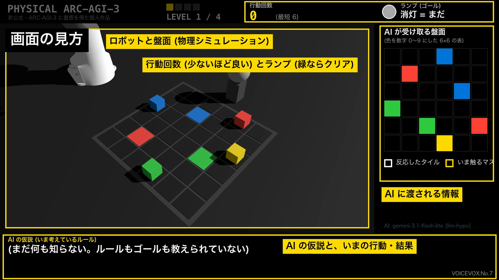
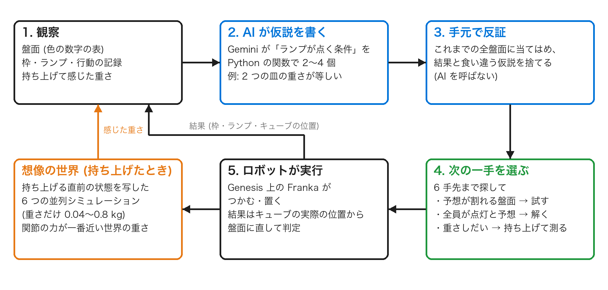
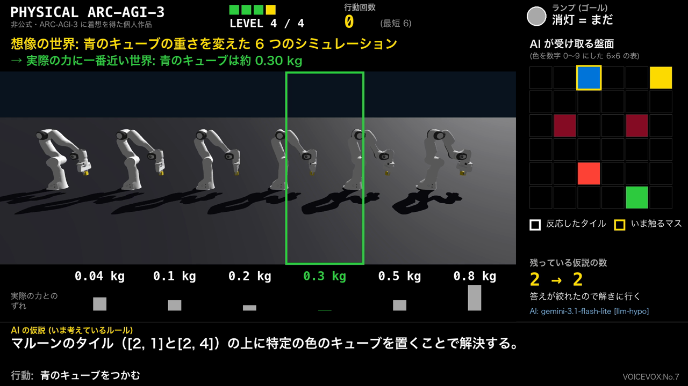
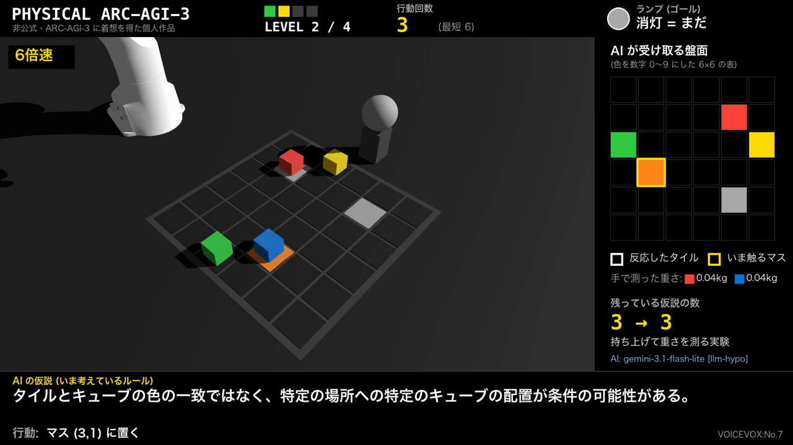
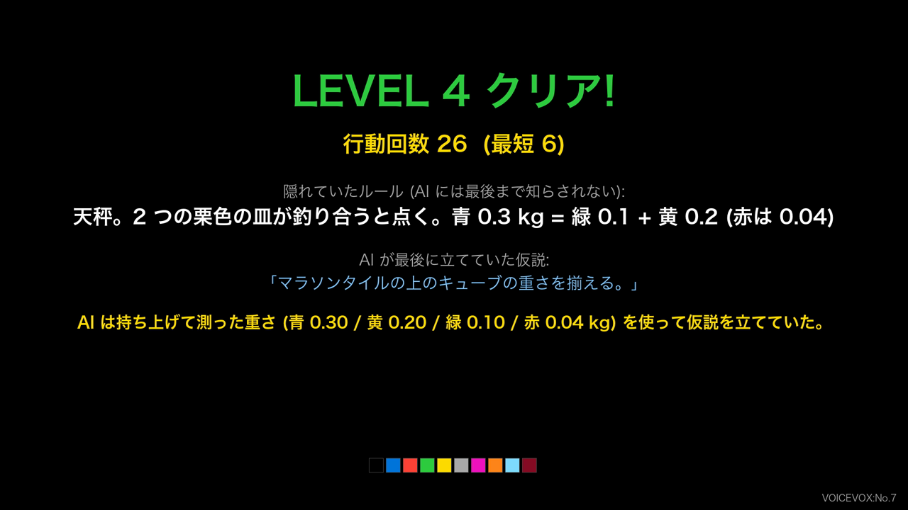

Physical AI 講座 2026 応用編1 最終課題 / Kakinotane

動画: <https://youtu.be/43sm8gRMhcY> ／ コード: <https://github.com/Kota-jpn/physical-arc-agi3>

> 非公式の個人作品です。ARC Prize Foundation の ARC-AGI-3 に着想を得ていますが、同財団とは関係がなく、公式のゲームやデータも使っていません。

**要点**

- **何を**: ルールもゴールも教えられないロボットアームが、キューブを置いて試し、隠れたルールを見つけてランプを点ける (ARC-AGI-3 に着想。Genesis + Franka、AI は Gemini を推論のみで使用)。
- **工夫**: AI に仮説を Python で書かせ、観測と食い違うものをコードで捨て、残った仮説の予想が割れる一手を選んでから動く。見た目で分からない重さは、持ち上げたときの関節トルクを、重さだけ変えた 6 つの並列シミュレーション (想像の世界) と比べて感じ取る。
- **結果**: 動画では 4 レベルすべてをクリア。重さのレベルは、物理なしの評価で、重さを感じられると 9 回中 5 回、感じられないと 5 回中 0 回。
- **わかったこと**: 壁は「最初の考えから抜け出せない」ことと、測った量を `==` で比べるような、言葉の推論と物理の継ぎ目だった (6 章)。

## 1. 何を作ったか

ロボットアームに、ルールもゴールも教えないまま机の上のパズルを解かせた。ロボットができるのは「キューブをつかむ」「マスに置く」の 2 つだけで、盤の横のランプを緑に点けるとクリアになる。何をすればランプが点くのかは教えていない。AI (Google の Gemini) は毎回、盤面と今までの行動の結果を見て「いまの仮説」と「次の一手」を考え、ロボットがそれを実行する。置いてみてタイルが光ったか、色が変わったかを見て、仮説を直していく。

4 つ目のレベルだけは、見ただけでは分からない性質 (キューブの重さ) がルールに関わる。ロボットはキューブを持ち上げたときの関節の力から重さを感じ取る。そのとき、重さだけを変えた 6 つのシミュレーション (「想像の世界」) で同じ動きを試し、実際の力に一番近い世界の重さを答えにする。AI はこの重さを使って仮説を立てる。ロボットだから試せる実験を、AI の試行錯誤に組み込むのがこの作品の中心である。

シミュレータは Genesis (CPU で動作)、ロボットは Franka Panda、AI は推論だけで使い、学習はしていない。

## 2. 元ネタの ARC-AGI-3

ARC-AGI-3 は 2026 年 3 月に公開された AI のベンチマークで、説明なしで始まる小さなゲームを、遊びながらルールを見つけて解けるかを測る。人間はすべてのゲームを解けるが、公開時の最先端の AI のスコアは 1% 未満だった。覚えた知識を引き出す力ではなく、初めての状況でその場でルールを学ぶ力を見るテストである (出典: <https://arcprize.org/blog/arc-agi-3-launch>)。

この力はロボットにこそ必要だと思った。現場のロボットは、初めて見る道具や説明書のない機械、毎回違う置き方に出会う。そのたびに学習し直すのではなく、少し試してルールをつかめれば、使える場面がずっと広がる。しかもロボットの一手は画面上のゲームより重い。時間がかかり、失敗すれば物が落ちる。そこで ARC-AGI-3 の形をそのまま机の上に持ち込み、ロボットで試せるようにした。

## 3. 画面の見方とゲームの中身

盤は 6×6 のマスで、床のタイルとキューブは ARC と同じ 10 色を使っている。AI に渡すのは画面右のような色の表 (色を 0〜9 の数字にしたもの) と、ランプの状態、これまでの行動とその結果だけである。

レベルは 4 つあり、それぞれ隠れたルールが違う。

| レベル | 隠れたルール (AI には教えない) | 手がかりとして見えるもの | 最短 |
|---|---|---|---|
| 1 | キューブを同じ色のタイルに置く。黄色のキューブはおとり | 正しく置くとタイルに白い枠が付く | 6 手 |
| 2 | オレンジのスイッチに何か載っている間だけ、灰色のタイルの本当の色が見える。その色に合わせて置く | 灰色のタイルに色が現れる | 6 手 |
| 3 | マゼンタの印の数 (3 個) と同じ高さの塔を水色のタイルの上に作る | 積むたびに印が 1 つずつ光る | 6 手 |
| 4 | 天秤。栗色の 2 枚の皿が釣り合うと点く。重さ (見えない) は青 0.3、黄 0.2、緑 0.1、赤 0.04 kg で、答えは 青 = 緑 + 黄 | 重い側の皿に白い枠が付く。重さは持ち上げたときに腕で感じる | 6 手 |

前のレベルのやり方がそのままでは通用しないようにした。レベル 1 の「同じ色に置く」は、レベル 2 では隠れた色を見つけないと使えず、レベル 3 では色ではなく数がルールになり、レベル 4 では見えない重さがルールになる。

## 4. AI の動かし方

AI は Gemini (gemini-3.1-flash-lite、無料枠) を推論だけで使う。提案の llm-hypo は次のように動く。

1. AI に「ランプが点く条件」の仮説を、言葉ではなく Python の関数で 2〜4 個書いてもらう。色、位置、数や高さ、マスどうしの関係 (同じ・等しい・大きい)、腕で測れる量、と種類の違う説明から出すように頼んでいる。
2. その関数を、これまでに見たすべての盤面に当てはめる。実際の結果と食い違う仮説はその場で捨てる。ここは手元のコードだけで済み、AI を呼ばない。
3. 6 手先までの盤面を全部たどり (キューブ 4 個なので数千通りで済む)、残った仮説同士で「ランプが点く」「点かない」の予想が割れる盤面があれば、そこへ行く手を試す。全部の仮説が「点く」と言う盤面があれば、そこへ解きに行く。どの盤面でも点かないと言う仮説は、試しようも使いようもないので、理由を添えて AI に書き直してもらう。
4. AI に聞き直すときは、観測したすべての盤面で「白い枠の付いたマスの数」と常に一致していた単純な量 (あるマスの高さ、自分と同じ色のタイルに載ったキューブの数、など) と、色ごとのタイルの枚数を、コードで探して添える。特定のレベル向けではない、どのレベルにも同じように出る手がかりである (後から足した。5 章と 6 章)。

ロボットの一手は取り消せないので、頭の中 (コード) で仮説を見分けてから動く、という考え方である。動画の右下にある「残っている仮説の数」が、この絞り込みの様子を表している。キューブの行き先を予想するのに小さなシミュレーションを使うが、ランプが点くかどうかの答えは使わない。それを知る手がかりは AI が書いた仮説だけにしてある。

比較のため、同じモデルで仮説をコードにしない llm-plain と、ARC-AGI-3 の Kaggle コンペ (Milestone 1) 上位チームの手軽な工夫 (直前の変化の要約、効果のなかった行動のメモ、同じ盤面に戻ったときの警告、数手のまとめ出し、レベルをまたぐメモ) を足した llm-tricks も作った (付録)。

### 触って、想像の世界と比べる

レベル 4 のために、ロボットにしかできない実験を足した。キューブを持ち上げると関節にかかる力 (トルク) が変わるが、その値は腕の姿勢やつかみ方でも変わるので、力から重さへの換算式を手で作るのは難しい。そこで、持ち上げる直前の腕の状態とキューブの位置をそのまま写した 6 つのシミュレーションを並べ、キューブの重さだけを 0.04 / 0.1 / 0.2 / 0.3 / 0.5 / 0.8 kg と変えて、同じ持ち上げ動作を試す。6 つの世界は Genesis の 1 つのシーンに並列に置けるので、1 回 0.3 秒ほどで済む。実際の関節の力に一番近い世界 (隣り合う世界の間は補間) の重さを「感じた重さ」とした。軽いキューブは 0.040〜0.044 kg、重いものは 0.298〜0.300 kg と、ほぼ正しく測れた。シミュレータの中の本当の重さは読んでいない。

感じた重さは AI に渡り、仮説の関数の中でも `state.mass(cube)` として使える。ある盤面でランプが点くかどうかの予想が、まだ持ち上げていないキューブの重さしだいで決まらないときは、そのキューブを持ち上げる手を「重さを測る実験」として選ぶ。ルールを見分ける実験と、物の性質を測る実験を、同じ選び方の中に入れたことになる。

## 5. 結果

### 動画のデモ (物理シミュレーション、llm-hypo)

4 レベルすべてをクリアした。行動回数はレベル 1 が 6 手 (最短と同じ)、レベル 2 が 22 手、レベル 3 が 18 手、レベル 4 が 26 手である。ただし、動画は 2 回の実行をつないでいる。レベル 1、2、4 は 10 月 28 日の実行で、このときレベル 3 は上限の 30 手で解けなかった。レベル 3 だけは、4 番目の手がかり (6 章) を足した後の 11 月 1 日の実行に差し替えた。この実行も 4 レベルを順に解いており、レベル 3 の AI は前のレベルの教訓を引き継いだ同じ条件である (この実行では 4 レベルとも解け、行動回数は 6 / 22 / 18 / 21 手。レベル 4 は、重さをそろえる仮説を持たないまま、キューブを持ち上げた拍子に釣り合って点いたので、動画には仮説から解いた 28 日の方を使った)。動画の中にも、レベル 3 だけ撮り直したことを表示している。AI の答えは毎回揺れ、28 日までに設定を直しながら 3 回実行している。前の 2 回は、1 回目がレベル 1 と 4、2 回目がレベル 1、2、4 をクリアし、どちらもレベル 3 は解けなかった (前の 2 回のレベル 4 は、下に書く作り直し前の版である)。

レベル 2 は 22 手かかった。AI はこのレベルでも重さを使う仮説を混ぜたため、プランナーが重さの関係しないレベルで「重さを測る」実験を何度か選び、手を無駄にした。重さを感じられるようにしたことの副作用である。最後は、スイッチにキューブが載り、灰色だったタイルの上に正しい色のキューブがそろったところでランプが点いた。

レベル 4 では、AI は最初「栗色のタイルに特定の色を置く」と考えていたが、4 つのキューブを持ち上げて重さを知った後は「2 つの皿の上の重さをそろえる」という仮説に変わり、その後クリアした。最後の仮説はルールの考え方として合っている。ただし 26 手かかっており、重さを知ってすぐに答え (青 = 緑 + 黄) を組み立てられたわけではない。

レベル 3 では、AI は積むたびに印が 1 つずつ光ることから塔の高さに目をつけ、「[3,3] に 4 つ全部積む」と考えて積んでいく途中、3 段目でランプが点いた。高さに注目したのは前進だが、AI の予想は 4 段で、「印の数だけ積む」というルールを言い当てたわけではない。

### 3 通りの比較 (物理なしの高速な評価)

ロボットを動かさずに同じルールだけで回せる評価も作り、3 通りを比べた。数字は「クリアできた割合 / クリアしたときの平均行動回数」。でたらめに動かす場合とヒューリスティックは 200 回、上限 200 手。AI の 3 通りは上限 40 手で、無料枠の制限のため 2〜3 回しか回せていない。

| やり方 | レベル 1 | レベル 2 | レベル 3 |
|---|---|---|---|
| でたらめに動かす (200 回) | 1% / 108 手 | 0.5% / 46 手 | 0.5% / 110 手 |
| 手書きのヒューリスティック (AI ではない参考値) | 100% / 6 手 | 100% / 8 手 | 100% / 6 手 |
| llm-plain (2 回) | 50% / 6 手 | 100% / 6 手 | 50% / 20 手 |
| llm-tricks (3 回) | 67% / 6 手 | 33% / 6 手 | 0% |
| llm-hypo (3 回) | 100% / 6 手 | 67% / 29 手 | 0% |

でたらめに動かすとほとんど解けないので、3 通りとも何かしらルールを推測して動いているのは確かである。llm-hypo はレベル 1 を 3 回とも最短で解き、そのとき AI を呼んだ回数は 1 レベルあたり平均 1.7 回と少なかった。仮説を手元のコードで確かめるので、AI に聞き直す回数自体が減ったのだと思う。

ただし、レベル 2 と 3 でははっきりした差が出ていない。レベル 3 は llm-plain が 2 回中 1 回解けたのに、llm-hypo は 3 回とも解けなかった。前日に修正前のコードで回したときは逆の傾向も出ている。2〜3 回の試行では、どのやり方が優れているとは言えない。なお、この表はレベル 4 を足す前のコードで測ったものである。

### レベル 4: 重さを感じることは役に立ったか

同じ llm-hypo で、感じた重さを渡す場合と隠す場合を比べた (物理なしの評価、4 レベルを続けて解く、上限 30 手)。重さを隠すと、AI に見えるのは盤面と枠とランプだけになる。6 章に書く「重さの比べ方」の修正の前後も並べる。

| やり方 | レベル 4 をクリアできた回数 | クリアしたときの行動回数 |
|---|---|---|
| でたらめに動かす (200 回、上限 200 手) | 0% | - |
| 手書きのヒューリスティック | 0% | - |
| llm-hypo、重さなし | 5 回中 0 回 | - |
| llm-hypo、重さあり (修正前) | 5 回中 1 回 | 28 手 |
| llm-hypo、重さあり (修正後) | 9 回中 5 回 | 13 / 14 / 27 / 29 / 30 手 |

重さを隠すと一度も解けず、重さを渡して比べ方を直すと 9 回中 5 回解けた。回数が少ないので確かなことは言えないが、腕で感じた重さが手がかりとして使われていることは、仮説の文面 (「2 つの皿の重さが等しい」など) からも確かめられる。修正後は 2 日に分けて回した (1 日目は無料枠の上限で 4 回で打ち切られ、翌日に 5 回。1 日目は 4 回中 3 回、2 日目は 5 回中 2 回)。同じ評価でのほかのレベルは、修正前の 5 回がレベル 1 で 5 回、2 で 3 回、3 で 2 回、修正後の 9 回が 1 で 9 回、2 で 3 回、3 で 1 回のクリアだった。レベル 2 と 3 は回によって大きく揺れており、この回数では修正の影響かどうかは分からない (修正は重さどうしの比較しか変えていない)。動画のデモは修正前のコードで実行したものである。

### レベル 3: 規則性の手がかりを足すと

6 章に書く「色合わせから抜け出せない」問題に対して、4 番目の手がかり (枠の数と一致する量) を足し、同じ物理なしの評価 (4 レベルを続けて解く、上限 30 手) を回した。

| llm-hypo | レベル 1 | レベル 2 | レベル 3 | レベル 4 |
|---|---|---|---|---|
| 手がかりなし (9 回) | 9 回 | 3 回 | 1 回 | 5 回 |
| 手がかりあり (5 回) | 4 回 | 2 回 | 3 回 | 4 回 |

レベル 3 は 9 回中 1 回から 5 回中 3 回に増えた。仮説の文面も、色合わせから「[3,3] の高さ」「マゼンタの上の個数と水色の上の個数が等しい」のような数の仮説に変わっている。ただし解けた 3 回も、正しい数をはじめから当てたというより、高さを変えて試すうちに点いたものが多い。回数が少ないので、ほかのレベルの増減は揺れの範囲だと考えている。

## 6. うまくいかなかったこと、わかったこと

一番の壁は、AI が最初に立てた考えから抜け出せないことだった。仮説を正しく捨てられても、正しい仮説を新しく思いつけなければ先に進めない。レベル 3 では、光った印を「置く場所の目印」と読んで、色合わせに戻ってしまう例が多かった。ARC-AGI-3 を扱った先行研究 (Tycho) にも、ルールの再現が正確でもゴールの特定は別の問題だという報告があり、同じことが起きていると思う。そこで、枠の付いたマスの数と常に一致する量をコードで探して AI に見せる手がかりを足したところ、レベル 3 は解けるようになってきた (5 章)。AI に考えを変えさせるには、「数えるべきもの」を観測から機械的に拾って見せるのが効いた。

仮説をコードにしたことで出てきた失敗もある。たとえば、空のリストに対する `all()` は真になるので、何も言っていないのに「いつでもランプが点く」と予想する仮説ができてしまった。セルの座標をリストとタプルで比べて永遠に一致しない仮説もあった。こうした失敗には、型の違いを吸収する、プロンプトで注意する、といった一般的な対処を入れた。特定のレベルの答えを教えるような対処は入れていない。

レベル 4 は一度作り直している。最初は「栗色のパッドに合計 0.5 kg 以上を載せる」というルールにしたが、重さを隠しても AI は 5 回とも解けた。キューブを全部パッドに載せれば点くので、重さを知る必要がなかったのである。測って比べなければこのことに気づけず、重さを使う課題のつもりで出してしまうところだった。そこで、全部載せても解けない天秤に変えた。天秤にしても、AI は「釣り合う」という考えになかなかたどり着かず、最初は 5 回中 1 回しか解けなかった。本物の天秤のように重い側の皿が分かる手がかりを足して、今の形にした。

AI 以外のところにも大きな穴があった。最初の版のプランナーは 3 手先までしか探していなかったため、キューブが積み重なってほどくのに 4 手以上かかる盤面では、正しい仮説を持っていても解き方を見つけられなかった。動画にした実行のレベル 4 では、AI は 12 手目で「2 つの皿の重さが等しい」という正しい仮説を書いていたのに、クリアは 26 手目だった。キューブ 4 個なら 6 手先までの盤面は数千通りしかないので、6 手先まで全部たどるように直すと、同じ記録の上ではその仮説が出た時点で解き方が見つかった。

探す深さを直したあとも、4 レベルを続けて解く評価ではレベル 4 は 5 回中 1 回しか解けなかった (重さを隠すと 5 回中 0 回)。記録を読むと、AI は「2 つの皿の重さが等しい」という正しい仮説を `w((2,1)) == w((2,4))` と書いていた。ところが測った重さは 0.30, 0.20, 0.10 kg のような小数で、計算機の上では 0.1 + 0.2 と 0.3 が等しくならない。だから「点く」と予想される盤面が見つからなかった。物理の世界で測った量は必ず誤差を含むので、正確に等しいかを問うこと自体がおかしい。そこで、重さどうしの `==` は「0.015 kg 以内なら等しい」と読むようにした。これは測定の分解能と天秤の許容差 (0.02 kg) に合わせた値である。同じ盤面と重さで確かめると、直したあとは最初の盤面から 3 手 (青を左の皿、緑と黄を右の皿) の解き方が見つかった。これまでの記録にある、重さを使う仮説 121 個を、正しく釣り合った盤面 (左に青、右に緑と黄) に当てはめ直すと、「点く」と予想するものは直す前の 24 個から 43 個に増えた。増えた 19 個のうち 10 個は「2 つの皿の重さが等しい」という正しい仮説そのもので、直す前はどれも、正しい盤面で「点かない」と予想していた。実際に 4 レベルを続けて解き直すと、レベル 4 は 9 回中 5 回解けた (直す前は 5 回中 1 回、重さを隠すと 5 回中 0 回)。言葉の世界の推論を物理の世界に持ち込むときに、こうした継ぎ目が出てくることが分かった。

逆に、効かなかった工夫もある。仮説に「ランプ」だけでなく「どのマスに枠が付くか」も予想させ、枠の予想が外れた仮説も捨てるようにしてみた。天秤の「重い側の皿に枠が付く」という手がかりを使えば、「左に 0.5 kg、右に 0.2 kg」のような的外れな仮説をすぐ捨てられるはずだった。しかし軽量のモデルには枠の関数を正しく書くのが難しく、まともな仮説まで捨てられて、有効な返事が 60 回中 11 回に減ったので取りやめた。

物理の面でもつまずいた。重いキューブを軽いキューブの上に積むと、少しずつ滑って塔が崩れた。原因を調べると、シミュレータの接触の計算で重さの比が大きいと起きる滑りで、Genesis の no-slip の反復とねじり摩擦を有効にすると止まった。

限界も多い。状態はシミュレータの正確な位置から作っていて、カメラ画像からの認識はしていない。重さの推定も、「想像の世界」と「実際の世界」が同じシミュレータなので、そのままでは実機ほどのずれは起きない。そこで「実際の世界」の側だけを想像とずらして、推定がどれだけ狂うかを調べた (`scripts/weigh_robustness.py`、レベル 4 の 4 個のキューブ)。

| 実際の世界に入れたずれ | 重さの推定誤差 (平均 / 最大) |
|---|---|
| なし | 0.001 / 0.002 kg |
| 関節トルクのセンサー雑音 0.05 Nm | 0.004 / 0.007 kg |
| 関節トルクのセンサー雑音 0.2 Nm | 0.016 / 0.031 kg |
| つかむ力が想定より弱い (12 N、想定 20 N) | 0.001 / 0.003 kg |
| 手に想定外の 0.1 kg (カメラなどを付けた想定) | 0.096 / 0.097 kg |

雑音やつかむ力のずれには強いが、腕そのもののモデルの誤差 (手に付けた想定外の重さ) は、そのまま重さの誤差になる。実機で使うなら、何も持たない状態で想像の世界との差を測っておく「風袋引き」のような較正が要る。どのレベルも 1 つのルールで解けるので、本家の難しさには遠い。本家は言葉や数字を使わないが、こちらは日本語で仮説を書かせており、レベル 3 は数を数える課題である。今後は、仮説の出し方を多様にすること (温度を変える、別のモデルを混ぜる、反例を見せる) と、試行回数を増やして比較をきちんとすることに取り組みたい。

## 7. 作るときに工夫したこと

ロボットとゲームの判定を分けた。ロボットは行動を実行するだけで、判定はしない。行動のあと、シミュレータからキューブの実際の位置を読み、一番近いマスに当てはめて「どのマスに何段積まれているか」を作る。これをルールだけを書いた小さなプログラム (`game.py`) に渡し、光るタイルやランプの状態を返してもらう。つかみ損ねてキューブが動かなければ、ゲームの側にもそれがそのまま現れる。同じ `game.py` を物理なしの高速な評価にも使っている。

AI の返事は、JSON として読めるか、その手がいまの盤面で実行できるか、仮説のコードが動くかを確かめ、だめなら理由を添えて 3 回まで出し直してもらう。無料枠のエラー (429 など) には待ち時間を倍々に延ばして再試行する。AI とのやり取りと実行した判断はすべてログに残し、そのログから AI を呼ばずに同じ動画を作り直せるようにした。今回の動画もこの方法で、画質と説明を直して作り直している。

## 8. 関連研究との関係

AI に世界のモデルをコードで書かせて確かめる研究はすでにある。WorldCoder (<https://arxiv.org/abs/2402.12275>) や Hypothesis Search (<https://arxiv.org/abs/2309.05660>) がそうで、ARC-AGI-3 に対しても、Python で書いた世界モデルを観察で確かめながら計画に使う研究 (<https://arxiv.org/abs/2605.05138>) や、仮説を作って試して直す Tycho (<https://arxiv.org/abs/2607.28287>) がある。なので、仮説をコードにして確かめること自体は新しくない。

今回足したと考えているのは 2 点である。1 つはこの考え方を、ロボットアームで遊ぶ ARC-AGI-3 風のゲームに持ち込んだこと。もう 1 つは、ロボットの一手が重いことを理由に、残った仮説を一番よく見分けられる行動を選ぶようにしたことである。後者は調べた範囲では明示的な例を見つけられなかったが、調査は限られているので見落としがあるかもしれない。

重さを感じる部分についても、部品はどれも先行例がある。LLM が答える前に物理シミュレーションで確かめる Mind's Eye (<https://arxiv.org/abs/2210.05359>)、LLM が書いたプログラムと物理エンジンで質量や摩擦を推定する LLMPhy (<https://arxiv.org/abs/2411.08027>)、持ち上げたときの関節トルクから質量を推定する研究 (<https://arxiv.org/abs/1907.11200>)、期待情報量で触り方を選んで物体の性質を推定する研究 (<https://arxiv.org/abs/2404.07344>) などである。今回の差分は、AI が書くルールの仮説が「まだ測っていない重さ」を参照でき、答えが重さしだいならその物を持ち上げる手を実験として選ぶこと、そしてその重さを並列の想像の世界との比較で求めることを、ARC 型のルール発見の 1 つの流れにまとめた点だと考えている。これも調べた範囲での話である。

## 9. 講義との関係

講義で扱った再現性と運用 (MLOps・RobOps) の考え方を、小さく実践した。依存ライブラリはバージョンを固定し、シミュレーションと初期配置は毎回同じになるようにした。AI とのやり取りもすべて記録して、あとから同じ判断を再生できる。評価は 1 コマンドで回せ、最終の実行も 1 本のスクリプトにまとめてある。

もう 1 つはオープンソースのありがたさである。Genesis の中身が公開されているので、タイルの色を出し入れしたりランプを足したり、つかみ方を調整したりと、環境を自分の問いに合わせて作り変えられた。おかしな動きがあっても、原因をたどって直せた。

再現手順は GitHub の README にある (`./run.sh`、`./eval.sh`、`scripts/final_run.sh`)。Python 3.11 / Genesis 1.4.4 / PyTorch 2.14.1。
